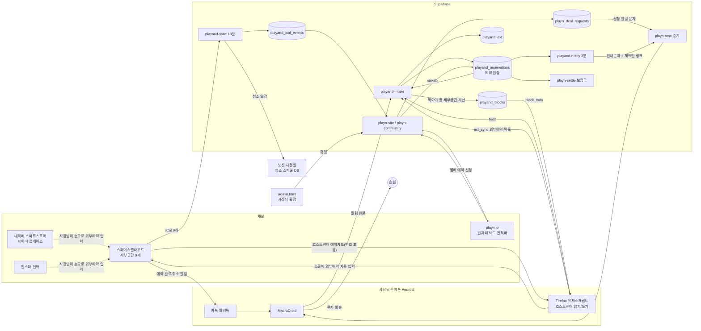

# Play N 예약 시스템 구조 (RESERVATION_FLOW)

> 기준일 2026-10-17 18:35 KST · 작성 Claude · 읽는 사람 사장님·Gemini
> 실제 코드(`playn-bot/*`, Supabase 함수 31개)와 DB 값을 직접 확인해서 쓴 문서다. 추측은 "추정"이라고 표시했다.
> 키·전화번호·계좌번호는 일부러 적지 않았다.

---

## 0. 한눈에

- **예약 원장은 Supabase `playand_reservations` 한 곳**이다. 스페이스클라우드·네이버·홈페이지 예약이 모두 여기로 모이고 안내문자·체크인·보증금·청소·중복막음이 전부 이 표를 보고 돈다.
- **빈자리 판단은 스페이스클라우드 캘린더(iCal 9개)가 기준**이다. 홈페이지 빈자리 보드도 이 iCal을 10분마다 받아서 계산한다.
- **노션은 "받기만 하는 화면"**이다. Supabase가 10분마다 청소 일정을 노션에 써 넣는다. 노션에서 고친 내용은 Supabase로 돌아오지 않는다.
- **가장 약한 고리는 사장님 운영폰 한 대**다. 카톡 알림 감지·호스트센터 읽기·외부예약 자동 입력·모든 문자 발송이 이 폰(MacroDroid + Firefox)에 걸려 있다.
- **네이버 예약은 아직 자동으로 안 들어온다.** 사장님이 스클 캘린더에 외부예약으로 직접 적어야 시스템이 안다. 이 사이에 중복예약이 날 수 있다.

---

## 1. 예약 접수와 채널 연동 흐름

### 1-1. 전체 지도

### 1-2. 채널별로 실제로 어떻게 들어오나

| 채널 | 들어오는 길 | 자동 여부 | 원장 ID 형태 | 번호 확보 |
|---|---|---|---|---|
| 스페이스클라우드 | ① 카톡 알림톡 → MacroDroid → `playand-intake`(kakao) ② 운영폰 Firefox가 호스트센터 예약카드를 읽어 `intake`(host) ③ iCal 9개를 `playand-sync`가 10분마다 수집 | 자동 (폰이 켜져 있을 때) | 숫자 예약번호 | ②에서 확보 |
| 네이버 스마트스토어·플레이스 | 사장님이 스클 캘린더에 "네이버 통대관 확정" 식 외부예약으로 직접 입력 → Firefox가 외부예약 목록을 읽어 `intake`(ext_sync) | **입력은 수동**, 이후 자동 | `ext:외부예약ID` | 사장님이 연락처 칸에 적어야 함 |
| 인스타·전화 | 네이버와 같은 방식 (스클 외부예약) | 수동 | `ext:` | 수동 |
| playn.kr 멤버 예약 | 빈자리 보드 → 견적바 → `/me/?book=1` → `playn-community`(member_request) → `playn_deal_requests` → 사장님 문자 → `admin.html`에서 확정 → `site:신청ID`로 원장 기록 | 신청은 자동, **확정·입금 확인은 수동** | `site:` | 가입 때 OTP 인증 |
| playn.kr 일반 손님 | 견적바 "예약 확정 신청하기"가 네이버 스마트스토어로 보냄 | 외부로 나감 | (네이버 경로로 다시 들어옴) | |

### 1-3. 데이터가 쌓이는 곳

| 표 | 하는 일 | 누가 씀 |
|---|---|---|
| `playand_reservations` | **예약 원장**. 지점·날짜·패키지·상태·이름·번호·문자 상태 | intake, playn-site(admin_decide) |
| `playand_ical_events` | 스클 iCal 9개 피드 원본. 빈자리 계산 기준 | playand-sync |
| `playand_ext` | 스클 캘린더 외부예약(네이버·전화·자동막음) 목록 | intake(ext_sync) |
| `playand_blocks` | 다른 세부공간에 넣어야 할 "막음" 작업 큐 (pending → done / delete_pending) | intake(block_todo) ↔ Firefox |
| `playn_deal_requests` | 홈페이지 멤버 예약·특가 신청 | playn-community, playn-site |
| `playand_notion_items` | Supabase 키 ↔ 노션 페이지 ID 연결표 | playand-sync |
| `playn_settle` | 체크인·보증금 입금 인증·퇴실 체크·환급 | playand-notify, playn-settle |
| `playn_extensions`, `playn_early_in` | 확정된 연장·조기입실 | AI 상담사, playn-perk |
| `playn_sms_out` / `playn_sms_in` | 모든 문자 발송·수신 기록, 미확인 감시 | playn-sms |
| `playand_config` | 모드 스위치·가격표·iCal 주소·노션 DB 등 설정 | 수동 |

현재 모드: `sms_mode=live` · `block_mode=live` · `ext_mode=live` (모두 9/25부터 실운영)

### 1-4. 홈페이지 빈자리 보드가 숫자를 만드는 법

`playn-site ?deals=1` (파일 `playn-bot/site/index.ts`의 `deals()`)

1. `playand_ical_events`에서 오늘~7일 일정을 가져와 지점·패키지 시간대와 겹치면 "마감"
2. `playn_deal_requests`에서 대기·확정 중인 홈페이지 신청도 "마감"으로 침 (스클에 아직 안 막혔어도 겹치지 않게)
3. 오늘 시작 1시간 전이 지난 패키지는 마감
4. 가격 = `playand_config.prices`[지점][패키지][등급 A~D]
5. 할인 규칙 `deal_rules` (fenced 모드)
   - D-3 이후 빈자리만 멤버 특가 20%
   - D-1·D-2는 정가 ("기다리면 싸진다" 학습 방지)
   - 당일은 예고 없이 하루 1자리만 35% 번개 (날짜 해시로 고름)
   - C등급(주말·연휴)과 B등급 야간·통대관, 12/24·12/31은 제외

**지연:** 스클에서 예약이 잡히고 보드에 반영되기까지 최대 약 10분 (iCal 수집 주기) + 스클 쪽 iCal 갱신 시간(확인 불가).

### 1-5. 예약 확정 뒤 자동으로 일어나는 일

| 순서 | 무엇 | 담당 | 주기 |
|---|---|---|---|
| 1 | 다른 세부공간 막음 계산 (통대관↔나이트↔커플, 연박 사이, 연장·조기입실 시간) | intake `computeBlocks()` | 폰이 block_todo 요청할 때 |
| 2 | 스클 캘린더에 외부예약 "스클 통대관 확정" 등 자동 입력 | 운영폰 Firefox | 위와 같음 |
| 3 | 안내문자 + 체크인 링크(`playn.kr/in/?k=`) 발송 | playand-notify → playn-sms → MacroDroid | 3분 |
| 4 | 노션 청소 일정 작성·수정·보관 | playand-sync | 10분 |
| 5 | 보증금 정산 링크 발급, 퇴실 4시간 뒤 미제출이면 기본 계산으로 사장님께 | playn-settle-guard | 10분 |
| 6 | 퇴실 후 후기·가입 문자 | playn-auto tick | 10분 |
| 7 | 취소 → 막음 자동 삭제, 안 되면 사장님께 "직접 지워주세요" 문자 | intake `onCancelled()` | 취소 감지 즉시 |

---

## 2. 노션 DB 연동 상태

**결론: 한 방향 실시간에 가까운 자동 동기화 (Supabase → 노션). 노션 → Supabase는 없음.**

| 항목 | 상태 | 근거 |
|---|---|---|
| 청소 스케줄 (지점별 DB 3개) | **자동.** 10분마다 iCal + 원장 + 연장·조기입실을 합쳐 "오전9시30분 퇴실 / 당일 12시 입실" 같은 제목을 만들고 새로 쓰거나 고치거나 보관 | cron `playand-sync-10min`, 마지막 실행 18:30 KST. 오늘 이후 자동 항목 9건 (연남 5·홍대 3·연트럴 1) |
| 연박 | 같은 지점·같은 번호가 퇴실일에 다시 들어오면 중간 청소를 만들지 않고 "연박"을 붙임 | sync `stayNext/stayPrev` |
| 수기로 쓴 노션 기록 | 퇴실 시각이 맞으면 "기존 기록 연결"로 잡고 지우지 않음 (`adopted`) | sync 4단계 |
| 노션에서 사장님이 고친 내용 | **Supabase로 안 돌아옴.** 다음 동기화 때 자동 제목으로 덮일 수 있음 | 읽는 코드 없음 |
| 지점 이용 안내 페이지 (notion.site) | 안내문자에 링크로 들어감. 내용 교체·비밀번호 가리기는 `playn-notion-write`로 **필요할 때만 수동 실행** | 크론 없음 |
| 예약 정보 자체 | 노션에 없음. 원장은 Supabase | |

---

## 3. 병목과 리스크 (심각한 순서)

### R1. 운영폰 한 대에 다 걸려 있음 (단일 장애점)
- 카톡 알림 감지·호스트센터 번호 수집·스클 외부예약 자동 입력·**모든 문자 발송**이 운영폰 하나다.
- 지금 수치: 호스트센터 마지막 읽기 10/17 01:30 KST (17시간 전), 카톡 알림 마지막 수신 10/16 14:55 KST. 최근 14일 문자 약 650건 중 확인 안 된 것 11건, 실패 1건.
- 폰이 꺼지거나 배터리 절약 모드로 MacroDroid가 죽으면 안내문자·막음 입력이 그 시간만큼 밀린다. `playn-sms watch`가 10분 넘은 미확인 문자를 푸시로 알려주긴 하지만 **호스트센터 읽기가 멈춘 것은 따로 경보가 없다.**

### R2. 네이버 예약이 들어오는 순간 시스템이 모름 (중복예약 창)
- 네이버 스마트스토어·플레이스 예약은 사장님이 스클 캘린더에 손으로 적기 전까지 원장·iCal·빈자리 보드 어디에도 없다.
- 그 사이 스클이나 홈페이지에서 같은 시간이 팔릴 수 있다. iCal 방식 자체도 실시간이 아니라 중복예약 위험이 "중간"으로 분류된다 (Hostex 기준: 수동 높음 / iCal 중간 / API 채널매니저 낮음).
- 번호 칸을 비워 두면 안내문자가 안 나간다. 지금도 오늘 이후 네이버·외부예약 2건이 번호 없이 들어와 있다.

### R3. 홈페이지 예약이 전부 수동 확정
- 신청 → 사장님 문자 → `admin.html` 확정 → 손님에게 계좌 안내 → **입금을 사장님이 눈으로 확인**.
- 50% 쿠폰은 30분 안에 전원 인증이 안 되면 자동 취소되는데 일반 신청은 사장님이 늦게 보면 손님이 그냥 네이버로 가버린다.
- 실적: 지금까지 홈페이지 신청 중 실제 확정 0건 (특가 2건 마감 처리, 테스트 1건). 최근 14일 방문자 147명 중 예약 관련 링크(스마트스토어·스클·네이버지도·빈자리 보드) 클릭은 6번.

### R4. 확정된 홈페이지 예약이 스클에 막히기까지 공백
- `site:` 예약은 원장에는 바로 들어가지만 스클 캘린더 막음은 운영폰 Firefox가 다음에 block_todo를 돌릴 때 생긴다.
- 그 사이 스클 손님이 같은 시간을 예약할 수 있다. 빈자리 보드는 신청 표를 같이 봐서 괜찮지만 **스클 쪽은 모른다.**

### R5. 노션 수정이 덮임
- 청소 매니저나 사장님이 노션 제목을 고쳐도 다음 10분 동기화에서 자동 제목으로 바뀔 수 있다 (자동 항목만 해당).
- 연장 규칙상 "노션 청소 일정도 같이 미뤄야" 하는데 노션에서 직접 미루면 원장은 모른다. 연장은 반드시 시스템(AI 상담사·연장권)으로 넣어야 맞게 돈다.

### R6. 코드 안에 운영 정보가 박혀 있음
- `playn-site`에 입금 계좌와 호스트 번호가 코드에 직접 들어 있다. 계좌를 바꾸면 함수를 다시 배포해야 하고 코드를 공유할 때 같이 나간다. `playand_config`로 빼는 게 맞다.
- 같은 정산 계산식이 `playn-settle`과 `playn-settle-guard` 두 곳에 있다 (코드 주석에도 "같이 고칠 것"). 한쪽만 고치면 금액이 달라진다.

### R7. 연트럴파크점 데이터가 비어 보임
- iCal상 연트럴 미래 일정이 0건이다 (오늘 0시 연박분까지만). 실제로 예약이 없는 건지 피드 문제인지는 이 자료만으로는 **판단할 수 없다.** 오늘 연트럴 통대관(외부예약)은 원장에 있다.

---

## 4. 자동화·수익화 개선 방향

난이도 = 사장님 손이 얼마나 가는지. 효과 = 매출·사고 예방.

### A. 바로 할 수 있는 것 (이번 주)

| # | 할 일 | 효과 | 난이도 |
|---|---|---|---|
| A1 | **"폰 숨 쉬는지" 경보**: 호스트센터 읽기(host·ext_sync)가 3시간 넘게 없으면 ntfy 푸시 + 관제실 빨간불 | R1 조기 발견 | Claude가 SQL 한 번 |
| A2 | **번호 없는 확정 예약 경보**: 입실 24시간 전인데 번호가 없으면 사장님께 "연락처 넣어주세요" | 안내문자 누락 방지 (지금 2건) | Claude |
| A3 | **홈페이지 신청 즉시 스클 막음**: 신청이 "대기"로 들어오는 순간 block 큐에 임시 막음을 넣고 마감되면 자동 삭제 | R4 해결 | Claude |
| A4 | 계좌·호스트 번호를 `playand_config`로 이동 | R6 | Claude |
| A5 | 노션 페이지에 "자동 작성 · 고치려면 관제실에서" 문구 + 사람이 고친 제목은 덮지 않게 (`adopted` 처리 확대) | R5 | Claude |

### B. 네이버 예약 자동 수집 (중복예약 줄이기)

쉬운 순서로:
1. **카톡/문자 알림으로 받기 (가장 쉬움)**: 네이버 예약도 사장님 폰으로 예약 완료 알림이 온다면 지금 스클 카톡 알림과 똑같이 MacroDroid가 그 알림을 `intake`로 넘기고 서버가 스클 외부예약을 자동으로 넣는다. 사장님 수동 입력이 사라진다. 네이버 알림 문구 샘플 2~3개만 있으면 파서를 만들 수 있다.
2. **스마트스토어 주문 API (커머스 API)**: 스마트스토어 상품 주문이 들어오면 주문 정보(옵션=날짜·패키지)를 받아 원장에 바로 넣는 방식. 판매자 센터에서 API 키를 발급받아야 한다. 알림 방식보다 정확하고 폰과 무관하다.
3. **채널매니저 도입**: 국내 숙박용 채널매니저는 많지만 스페이스클라우드·네이버 공간대여를 함께 묶는 제품은 확인하지 못했다. 지금 구조가 사실상 자체 채널매니저 역할을 하고 있어 새로 사는 것보다 1·2번이 맞다.

### C. 홈페이지 예약을 "바로 확정"으로 (수익화 핵심)

지금 홈페이지 예약이 안 되는 가장 큰 이유는 **기다려야 해서**다. 네이버는 결제하면 끝나는데 홈페이지는 신청 → 사장님 확인 → 입금 → 확인을 거친다.

1. **입금 자동 확인 (가장 쉬움)**: `playn-sms`에는 받은 문자 중 은행 입금 알림을 "deposit"으로 분류하는 코드가 이미 있다. 그런데 `playn_sms_in` 기록이 0건이라 **운영폰 MacroDroid의 "문자 받으면 서버로 올리기" 매크로가 안 켜진 상태**로 보인다. 이것만 켜면 "금액 + 입금자명"이 신청과 맞을 때 자동 확정하는 코드를 붙일 수 있다. 새 계약이 필요 없다. 폰 의존은 남는다.
2. **토스페이먼츠 가상계좌 + 입금 웹훅**: 신청마다 가상계좌를 주고 `DEPOSIT_CALLBACK` 웹훅이 오면 서버가 바로 확정·스클 막음·안내문자까지 처리. 폰이 필요 없고 10초 안에 응답하면 되는 구조라 지금 Supabase 함수에 붙이기 쉽다. 가맹 심사가 필요하다.
3. **카드 결제(토스페이먼츠 결제창)**: 가장 전환이 좋지만 수수료가 생긴다. 그래도 스클 수수료보다 낮으면 이득.

빈자리가 확실한 시간(iCal + 신청 표로 이미 판단 중)은 **자동 확정**하고 애매한 경우만 사장님이 보는 방식으로 바꾸면 사장님 손도 줄고 전환도 오른다.

### D. 매출을 올리는 쪽

| 아이디어 | 근거 데이터 | 방법 |
|---|---|---|
| 홈페이지 예약 버튼 기본값을 "멤버 예약"으로 | 지금 견적바는 특가 슬롯이 아니면 네이버로 보냄 → 수수료 나감 | 정가 슬롯도 `/me/?book=1`로 보내고 가입 혜택(첫 예약 쿠폰)으로 당김 |
| 빈자리 보드 → 공실 알림 구독 | 방문자 147명 중 빈자리 보드 지점 탭 클릭이 1명 | "이 날 비면 알려줘" 버튼 → 카카오 채널·문자로 당일 번개 알림 (이미 `playn-growth vacancy`가 있음, 받을 사람만 늘리면 됨) |
| 연박·연장 판매 | 연박·연장은 이미 원장·노션·막음까지 자동 | 체크인 화면에 "다음 날 비어 있어요 · 연박 ○○원" 노출 |
| 성수기 가격 | `force_c`, `exclude_mmdd`로 이미 제어 가능 | 12/24·25·31은 사장님 결정 뒤 config만 바꾸면 보드·견적에 같이 반영 |
| 예약 경로 측정 | 체크인 때 "어떻게 알게 되셨어요?" 응답이 30일 4건뿐 | 체크인 필수 화면에 넣어 응답률 올리기 → 인스타 효과를 숫자로 확인 |

### 추천 순서

1. A1·A2·A3 (사고 예방, Claude 작업만으로 됨)
2. B-1 네이버 알림 자동 수집 (사장님은 알림 샘플만 주면 됨)
3. C-1 입금 문자 자동 확인 → 효과 보고 C-2 가상계좌로
4. D 항목은 C가 된 뒤 (확정이 빨라야 홍보가 매출로 이어짐)

---

## 5. 오늘 기준 수치 (2026-10-17)

| 항목 | 값 |
|---|---|
| 최근 30일+ 원장 | 스클 확정 13 · 외부(네이버 등) 확정 11 · 취소 스클 3·외부 2·홈페이지 1 |
| 오늘 이후 확정 예약 | 9건 (연남 5 · 홍대 3 · 연트럴 1) |
| 스클 막음 큐 | 완료 35 · 삭제 대기 1 · 오류 0 |
| 노션 자동 청소 항목 (오늘 이후) | 9건, 모두 자동 작성분 |
| 보증금 정산 (최근 30일) | 환급 완료 11 · 링크 발급 8 · 체크인 2 · 보류 1 · 무효 8 |
| 문자 (14일) | 발송 확인 640 · 미확인 11 · 실패 1 |
| 홈페이지 (14일) | 방문자 147명 · 조회 375 · 예약 관련 링크 클릭 6번 |
| 받은 문자 기록 (`playn_sms_in`) | 0건 (수신 매크로 미작동 추정) |
| 홈페이지 신청 누적 | 확정 0 · 마감 2 · 테스트 1 |

---

## 6. 파일·함수 위치 (Gemini 감사용)

| 기능 | 위치 |
|---|---|
| 예약 수신·막음 계산 | `playn-bot/intake/index.ts` (함수 `playand-intake`) |
| iCal 수집·노션 청소 동기화 | `playn-bot/sync/index.ts` (`playand-sync`, 10분) |
| 안내문자 | `playn-bot/notify/index.ts` (`playand-notify`, 3분) |
| 문자 중계·감시 | `playn-bot/sms/index.ts` (`playn-sms`, watch 5분) |
| 빈자리·특가·사장님 확정 | `playn-bot/site/index.ts` (`playn-site`) |
| 멤버 예약·견적·쿠폰·N CREW 인증 | `playn-bot/community/index.ts` (`playn-community`) |
| 보증금 정산 | `playn-bot/settle/`, `playn-bot/settle-guard/` |
| 연장권·조기입실 | `playn-bot/perk/index.ts` |
| 노션 안내 페이지 편집 | `playn-bot/notion-write/index.ts` (수동) |
| 홈페이지 보드·견적바 | `playn-help/index.html` (`.vm`, `.qbar`) |
| 멤버 예약 화면 | `playn-help/me/index.html` |
| 사장님 확정 화면 | `playn-help/admin.html` |
| 관제실 | `playn-help/hq/index.html` |

## 참고한 자료
- [Hostex — How to avoid double bookings](https://hostex.io/blog/how-to-avoid-double-bookings/) (iCal 지연·채널매니저 비교)
- [Hostaway — Double booking](https://www.hostaway.com/glossary/double-booking/)
- [토스페이먼츠 — 입금 알림 웹훅으로 간편하게 받는 방법](https://www.tosspayments.com/blog/articles/paytech-6)
- 예약 플랫폼 iCal 통합 사례: [Reservation-Platform-MCP-Server iCal 가이드](https://glama.ai/mcp/servers/@pak3430/Reservation-Platform-MCP-Server/blob/fd75aad41ef2cd61bd3daa5bae72ec8b7bf1876b/ICAL_SETUP_GUIDE.md)

---

## 7. 적용 기록 (2026-10-17 사장님 승인 "다 업그레이드")

| # | 상태 | 내용 |
|---|---|---|
| A1 | ✅ 적용·10/18 수정 | `playand_watchdog()`: 운영폰은 예약 알림이 올 때만 호스트센터를 읽는다. 그래서 시간 기준이 아니라 **마지막 읽기 이후 새 예약·새 막음이 30분 넘게 처리 안 됐을 때만** ntfy 푸시 + 관제실 이슈 `rsv:phonebeat`(crit). 처리 안 된 일이 없으면 자동 해제 |
| A2 | ✅ 적용 | 같은 함수: 연락처 없는 외부예약(ext:)이 이용일 2일 안이면 사장님 문자 + 관제실 이슈 |
| A3 | ✅ 적용 | `playand-intake` v10: 홈페이지 신청(pending)이 들어오면 스클 전 세부공간에 "홈페이지 예약 신청" 막음. 마감·만료되면 자동으로 삭제 대기 |
| A4 | ✅ 적용 | `playn-site` v11: 입금 계좌·문의 번호를 `playand_config` `bank_account`·`host_phone` 키로 바꿀 수 있음(키가 없으면 기존 값) |
| A5 | ✅ 적용 | `playand-sync` v7: 마지막으로 자동 작성한 제목과 노션 제목이 다르면 사람이 고친 것으로 보고 덮어쓰지 않음(`playand_notion_items.locked`). 그 항목은 이후 연장 등 자동 변경도 안 들어가니 다시 자동으로 돌리려면 locked=false |
| B·C·D | 대기 | 네이버 알림 샘플·입금 문자 매크로 등 사장님 준비가 필요한 항목 |

---

## 8. 지금 상태 점검 (2026-10-18 02시)

| 항목 | 값 | 뜻 |
|---|---|---|
| 호스트센터 마지막 읽기 | 10/17 20:03 | 그 뒤로 새 예약 0건이라 읽을 일이 없었음(정상). 운영폰은 예약 알림이 올 때만 읽는다 |
| 운영폰 경보 | 10/18 01시 오경보 → 기준 수정 후 해제 | 시간 기준(3시간)을 "새 일이 30분 넘게 처리 안 됨" 기준으로 바꿈 |
| 연락처 없는 외부예약 | 1건 열림 (`rsv:extnophone`) | 연트럴 10/17 당일 현금예약 |
| 오늘 이후 확정 예약 | 9건 | 10/17과 같음 |
| 스클 막음 큐 | 완료 35 · 삭제 대기 1(11/14, 10/16부터 대기) | 삭제 대기 1건은 호스트센터 캘린더에서 직접 지우거나 다음 읽기 때 처리 |
| 받은 문자 기록 | 0건 | 입금 문자 매크로가 아직 안 켜짐 (B·C의 전제) |
| 홈페이지 신청 | 마감 2 · 테스트 1 | 실제 신청은 아직 없음 |
